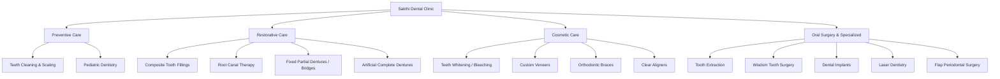

# 🦷 Sakthi Dental Clinic — Web Application

[](https://sakthi-dental-clinic-dusky.vercel.app/)
[](https://react.dev/)
[](https://vitejs.dev/)
[](https://tailwindcss.com/)
[](LICENSE)

> 🌐 **Live Website:** [Sakthi Dental Clinic | Specialized Dental Care in Hosur, Tamil Nadu](https://sakthi-dental-clinic-dusky.vercel.app/)  
>  
> **Specialized Dental Care for Women, Children & Families in Hosur, Tamil Nadu.**  
> A modern, patient-first web application designed to deliver compassionate, transparent, and expert-led dental healthcare information with a soothing, accessible digital experience.

---

## 📋 Table of Contents

- [Overview](#-overview)
- [Key Features](#-key-features)
- [Tech Stack](#-tech-stack)
- [Project Architecture](#-project-architecture)
- [Getting Started](#-getting-started)
  - [Prerequisites](#prerequisites)
  - [Installation](#installation)
  - [Environment Variables](#environment-variables)
  - [Development Server](#development-server)
  - [Production Build](#production-build)
- [Clinical Services & Treatments](#-clinical-services--treatments)
- [Medical Team & Leadership](#-medical-team--leadership)
- [Clinic Contact & Location](#-clinic-contact--location)
- [Deployment](#-deployment)
- [Contributing](#-contributing)
- [License](#-license)

---

## 🌟 Overview

Sakthi Dental Clinic has been serving the community of Hosur since **2004**. Founded and led by **Dr. Anupriya** (20+ years of clinical expertise), the clinic blends clinical excellence with gentle, patient-centered care.

This web application serves as the clinic's official digital portal—enabling patients to explore treatments, learn about specialists, access emergency and consultation guidance, calculate appointments, and find clinic directions seamlessly across all device sizes.

---

## ✨ Key Features

- **🌸 Calming & Accessible UI:** Carefully curated palette of lavender, soft sky blue, and blush tones with Fraunces serif display and Plus Jakarta Sans typography.
- **♿ Accessibility First:** Includes a skip-to-content bypass link, semantic landmark HTML, full keyboard navigation, and full support for `prefers-reduced-motion`.
- **🦷 15 Categorized Dental Treatments:** Comprehensive breakdown of preventive, restorative, cosmetic, and oral surgical procedures with intuitive filter controls.
- **👩‍⚕️ Specialist Roster:** Showcases profiles of clinical specialists across prosthodontics, endodontics, orthodontics, oral surgery, and implantology.
- **🗺️ Interactive Map & Direct Contact:** Direct calling integration, interactive Google Maps location view, and copy-to-clipboard functionality for addresses and phone numbers.
- **❓ Interactive FAQ System:** Collapsible accordion addressing consultation queries, appointment bookings, pediatric care, and pain management.
- **⚡ Ultra-Fast Performance:** Built on Vite 8, React 19, and Tailwind CSS v4 for sub-second page loads and zero layout shift.
- **🤖 AI-Ready Infrastructure:** Pre-configured with Google Gemini API SDK (`@google/genai`) for intelligent assistant capabilities.

---

## 🛠 Tech Stack

| Category | Technology |
| :--- | :--- |
| **Framework** | [React 19](https://react.dev/) (with JSX & React DOM) |
| **Routing** | [React Router v7](https://reactrouter.com/) |
| **Build Tool & Bundler** | [Vite 8](https://vitejs.dev/) |
| **Styling** | [Tailwind CSS v4](https://tailwindcss.com/) with `@tailwindcss/vite` |
| **Animations** | [Framer Motion](https://www.framer.com/motion/) |
| **Icons** | [Lucide React](https://lucide.dev/) |
| **AI Capabilities** | [Google GenAI SDK](https://github.com/google/generative-ai-js) (`@google/genai`) |
| **Language & Validation** | JavaScript (ESModules) & TypeScript 7 (`tsc --noEmit`) |

---

## 📂 Project Architecture

```plaintext
sakthi-dental-clinic/
├── src/
│   ├── assets/
│   │   └── images/              # Hero, founder portrait, and treatment photography
│   ├── components/              # Reusable atomic UI components
│   │   ├── Button.jsx           # Stylized motion button with variants
│   │   ├── ClinicMap.jsx        # Google Maps iframe embed with directions CTA
│   │   ├── ContactForm.jsx      # Patient inquiry form with client-side validation
│   │   ├── ContactInfo.jsx      # Clinic phone, address, and hours display
│   │   ├── DoctorCard.jsx       # Doctor profile card with pastel badges
│   │   ├── FAQAccordion.jsx     # Accessible FAQ accordion component
│   │   ├── Footer.jsx           # Global footer with navigation & legal links
│   │   ├── Navbar.jsx           # Responsive header with mobile drawer navigation
│   │   ├── PolicySection.jsx    # Privacy policy text renderer
│   │   ├── SectionHeader.jsx    # Standardized section headings & eyebrows
│   │   └── TreatmentCard.jsx    # Interactive treatment card with modal detail
│   ├── data/
│   │   ├── faqData.js           # FAQ database questions & categorized answers
│   │   └── privacyPolicyData.js # Formal clinic privacy statement & terms
│   ├── pages/
│   │   ├── About.jsx            # Founder story, clinic history & team
│   │   ├── Contact.jsx          # Map, direct lines & consultation inquiry form
│   │   ├── FAQ.jsx              # Frequently asked questions view
│   │   ├── Home.jsx             # Landing page with hero, amenities, and highlights
│   │   ├── PrivacyPolicy.jsx    # Compliance, patient data, and privacy terms
│   │   └── Treatments.jsx       # Filterable catalog of all 15 clinical procedures
│   ├── sections/                # Modular landing page sections
│   │   ├── Amenities.jsx        # Clinic comfort & sterilization standards
│   │   ├── AppointmentCTA.jsx   # Consultation call-to-action banner
│   │   ├── DoctorsTeam.jsx      # Comprehensive specialist directory
│   │   ├── FounderSection.jsx   # Dr. Anupriya's clinical journey & milestones
│   │   ├── Hero.jsx             # Main hero banner with quick callouts
│   │   ├── Services.jsx         # Highlighted services preview
│   │   ├── TreatmentsGrid.jsx   # Categorized procedure browser
│   │   └── WhyChooseUs.jsx      # Clinic value propositions
│   ├── App.jsx                  # Main router configuration & title manager
│   ├── index.css                # Global styles, fonts, and design tokens
│   └── main.jsx                 # Application entry point
├── .env.example                 # Environment variables blueprint
├── index.html                   # HTML template with SEO tags & Google Fonts
├── metadata.json                # Project description & applet metadata
├── package.json                 # Project dependencies & npm scripts
├── tsconfig.json                # TypeScript configuration
├── vercel.json                  # Vercel deployment routing rules
└── vite.config.ts               # Vite configuration with Tailwind CSS v4 & asset pipeline
```

---

## 🚀 Getting Started

### Prerequisites

Ensure you have one of the following installed:
- **Node.js**: `v18.0.0` or higher (Node 20+ recommended)
- **npm**: `v9.0.0` or higher (or **pnpm** / **bun**)

### Installation

1. **Clone the repository:**
   ```bash
   git clone https://github.com/VIJAYAPANDIANT/sakthi-dental-clinic.git
   cd sakthi-dental-clinic
   ```

2. **Install project dependencies:**
   ```bash
   npm install
   # or
   pnpm install
   # or
   bun install
   ```

### Environment Variables

Copy the example environment configuration:
```bash
cp .env.example .env
```

Configure the following variables in your `.env` file as needed:

| Variable | Description | Default / Example |
| :--- | :--- | :--- |
| `GEMINI_API_KEY` | *(Optional)* Google Gemini API Key for AI features | `MY_GEMINI_API_KEY` |
| `APP_URL` | Base public deployment URL | `http://localhost:3000` |
| `VITE_CONTACT_FORM_ENDPOINT` | *(Optional)* Endpoint for form submissions (e.g. Formspree) | `""` *(runs in demo validation mode)* |

### Development Server

Start the local Vite development server:
```bash
npm run dev
```

The application will be live at:
👉 **`http://localhost:3000`**

### Production Build

To compile and bundle the application for production:
```bash
npm run build
```

Preview the production build locally:
```bash
npm run preview
```

Run TypeScript verification:
```bash
npm run lint
```

---

## 🩺 Clinical Services & Treatments

The clinic offers 15 specialized procedures across 4 primary domains:



---

## 👩‍⚕️ Medical Team & Leadership

### Founder & Chief Dentist
- **Dr. Anupriya** (B.D.S.)
  - *Founder & Clinical Director*
  - 2000: Dental Degree Graduate
  - 2004: Established Sakthi Dental Clinic in Hosur
  - 6 Years at Mathura Clinic
  - 10+ Years Consultant at Primary Health Center (Chandara Hospital)
  - 20+ Years of Dedication to Family & Pediatric Dentistry

### Visiting Specialists
- **Dr. Ananya Iyer** — *Prosthodontist*
- **Dr. Meera Subramanian** — *Endodontist*
- **Dr. Arvind Kumar** — *Dental Surgeon*
- **Dr. Sneha N** — *Orthodontist*
- **Dr. Srinivas Rohit Ramanujam** — *Implantologist*
- **Dr. Balu** — *Laser Surgeon*
- **Dr. Vikram Raj Kishore** — *Clear Aligners Specialist*
- **Dr. Ajay Jumar** — *Oral & Maxillofacial Surgeon*

---

## 📍 Clinic Contact & Location

- **🌐 Website:**  
  [Sakthi Dental Clinic | Specialized Dental Care in Hosur, Tamil Nadu](https://sakthi-dental-clinic-dusky.vercel.app/)
- **🏥 Address:**  
  B2/8, SBM Layout, Anthivadi,  
  Hosur, Tamil Nadu 635109, India
- **📞 Phone Numbers:**  
  - [+91 98628 90897](tel:+919862890897)  
  - [+91 93632 98118](tel:+919363298118)
- **✉️ Email:**  
  [info@sakthidentalclinic.in](mailto:info@sakthidentalclinic.in)
- **🕒 Consultation Hours:**  
  *Consultation timings are confirmed prior to appointments. Please contact the clinic by phone to verify daily specialist availability.*

---

## 🌐 Deployment

The production application is live at:  
👉 **[Sakthi Dental Clinic | Specialized Dental Care in Hosur, Tamil Nadu](https://sakthi-dental-clinic-dusky.vercel.app/)**

### Vercel Deployment

The project includes a ready-to-deploy [`vercel.json`](vercel.json) configured for single-page application (SPA) routing:

```json
{
  "rewrites": [
    {
      "source": "/(.*)",
      "destination": "/index.html"
    }
  ]
}
```

Deploy in one click or via Vercel CLI:
```bash
npm install -g vercel
vercel
```

---

## 🤝 Contributing

Contributions, feature requests, and improvements are welcome!

1. Fork the repository
2. Create your feature branch (`git checkout -b feature/NewFeature`)
3. Commit your changes (`git commit -m 'feat: Add NewFeature'`)
4. Push to the branch (`git push origin feature/NewFeature`)
5. Open a Pull Request

---

## 📄 License

This project is licensed under the [MIT License](LICENSE).

---

<p align="center">
  Made with 💜 for <strong>Sakthi Dental Clinic</strong> • Hosur, Tamil Nadu
</p>
